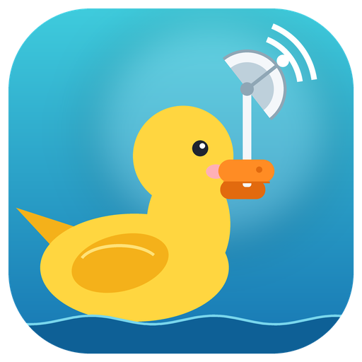

<p align="center">
  <br>
  <b>Duck Scanner</b><br>
  <sub>Unofficial Cloudflare WARP endpoint scanner &amp; config maker</sub>
</p>

---


**Duck Scanner** finds Cloudflare WARP endpoints that actually answer from your
network — using a *real* WireGuard handshake (not a TCP ping) — and turns the
good ones into ready-to-import configs for **OneXray**, **Xray**, **Hiddify**,
**AmneziaWG**, and the official **WireGuard** app. It also registers the WARP
accounts for you and (optionally) live-tests every Xray config with a real
`xray` binary before it ships it to you.

> ⚠️ **Unofficial.** This project is not affiliated with, endorsed by, or
> connected to Cloudflare. It speaks the WARP client API and the WireGuard /
> MASQUE protocols directly. Use it at your own discretion.

## What it can do

| Config type | Tag in outputs | What it is |
|---|---|---|
| Plain WARP | `WARP-NN` | WireGuard (UDP) to a scanned endpoint |
| WARP on WARP | `WoW-NN` | A second WARP account tunneled through the first |
| AmneziaWG | `AWG-NN` | AmneziaWG `.conf` with jumbo options for UDP-blocked networks |
| MASQUE | `MASQUE-NN` | WARP carried over MASQUE (HTTP/3 or HTTP/2) — what the 1.1.1.1 app uses |
| MASQUE on MASQUE | `MoM-NN` | A MASQUE tunnel dialed through another MASQUE tunnel *(experimental)* |
| GOOL | `GOOL-NN` | WireGuard WARP carried inside a MASQUE tunnel |

Every scanned endpoint is verified with a genuine WireGuard handshake
(`Noise_IKpsk2_25519_ChaChaPoly_BLAKE2s`, exactly what the WARP client does),
so a "found" endpoint is one that really completed authentication — not one
that merely opened a port. MASQUE endpoints are probed with real HTTP/3 (QUIC)
or HTTP/2 (TCP) connections to `consumer-masque.cloudflareclient.com`.

## Quick start

### Option A — Windows .exe (no Python needed)

Download **`Duck-Scanner.exe`** from the [latest release](../../releases).
Double-click it, and it opens the web interface at
`http://127.0.0.1:8765` in your browser.

### Option B — Python (Windows / Linux / macOS)

```bat
start.bat
```

or manually:

```bash
pip install "cryptography"
python warp_web.py        # opens http://127.0.0.1:8765
```

The web interface runs **on `127.0.0.1` only** — your WARP private keys never
leave this machine. Pick your options, hit *Start scan*, wait, and download
the zip of configs when it finishes.

> **WARP account registration is blocked in your country?** Enable the proxy
> option in the UI before starting — it is used *only* to create the account,
> the scan itself runs direct on your own connection.
> [Details](#accounts--privacy).

### Option C — command line

```bash
pip install "cryptography"
python warp_scan.py --single 25 --wow 5 --amnezia 20 --masque 10
```

Outputs are written to `warp_out/` (one folder per app) plus
`warp_out/warp_configs.zip`. Full flag list:

```
--no-proxy                 don't use a proxy when registering WARP accounts
--proxy-type {socks5,http} registration proxy type (default: socks5)
--proxy-host HOST          registration proxy host (default: 127.0.0.1)
--proxy-port PORT          registration proxy port (default: 10808)
--stack {v4,v6,dual}       IP stack to scan (default: v4)
--single N                 plain WARP configs (default: 25)
--wow N                    WARP-on-WARP configs (needs 2 accounts; default: 5)
--amnezia N                AmneziaWG configs (default: 20)
--masque N                 MASQUE configs (default: 0)
--mom N                    MASQUE-on-MASQUE configs (experimental)
--gool N                   WireGuard-inside-MASQUE configs
--masque-transport {h3,h2} h3 = QUIC/UDP, what the 1.1.1.1 app tries first;
                           h2 = TCP, for networks that block UDP (e.g. iPhone)
--no-baseline              don't add the standard MASQUE endpoint on every port
--no-fragment              don't use the TLS-hello fragment on HTTP/2 (Xray)
--xray PATH                path to xray(.exe) used to live-test the Xray configs
--xray-verify N            how many endpoints to test (default: 12)
--jc N                     AmneziaWG jumbo count (default: 4)
--jmin N                   AmneziaWG min jumbo (default: 40)
--jmax N                   AmneziaWG max jumbo (default: 70)
--candidates N             candidate IP:port pairs to draw (default: 4000)
--probes N                 handshake probes per candidate (default: 3)
--timeout SECONDS          per-probe timeout (default: 1.5)
--workers N                parallel workers (default: 200)
--identity PATH            identity store (default: warp_identity.json)
--outdir PATH              output directory (default: warp_out)
--zip / --no-zip           also write warp_configs.zip (default: on)
```

## What a scan produces

After a scan you get a zip with one folder per client app, plus a `README.txt`
inside. The standard MASQUE endpoint (`162.159.198.2`, v4) is always listed on
all seven MASQUE ports as a baseline, alongside everything the scan found.

| File | Import it where |
|---|---|
| `onexray/onexray_raw.json` | **OneXray** (iOS, macOS, Windows, Android) → expert mode → *Raw JSON* → import. Needs OneXray 26.10.5+ (Xray-core 26.9.30+). DNS goes through the tunnel; it picks the fastest endpoint that connects. **Start here for MASQUE.** |
| `onexray/onexray_raw_alt_sni.json` | Same, with a different TLS name — only if the first one won't connect. |
| `xray/warp_xray_auto.json` | Plain Xray: `xray run -c warp_xray_auto.json`. Local SOCKS5 `127.0.0.1:10808`, HTTP `127.0.0.1:10809`. Includes an observatory + least-ping balancer across all exits. |
| `xray_endpoints/<tag>.json` | One runnable config per endpoint (pin to a single exit). |
| `hiddify/warp_hiddify.json` | **Hiddify**: copy all of it, then **+** → *Add from clipboard*. Plain WARP and WARP-on-WARP only — Hiddify has no MASQUE and can't read Xray files. |
| `amnezia/AWG-NN.conf` | **AmneziaWG** app: import the `.conf`. |
| `wireguard/WARP-NN.conf` | Official **WireGuard** app: import the `.conf` (or the zip). |

> v2rayN's custom-config import didn't work for us — use plain Xray or OneXray.

### MASQUE transport: HTTP/3 vs HTTP/2

Per Cloudflare's own changelog, the official 1.1.1.1 client uses **MASQUE over
HTTP/3** and falls back to **HTTP/2 over TCP** only when HTTP/3 is blocked.
Duck Scanner defaults to the same:

- **HTTP/3** (default) — QUIC/UDP. Use on normal desktop networks.
- **HTTP/2** — TCP. Pick this for the iPhone file (iOS blocks most UDP) or any
  network that blocks UDP.

## Optional: live-test with a real `xray`

If you give the scanner a path to `xray.exe` (or `xray`), it runs each
generated Xray/OneXray config through a real `xray` with a time-boxed connect
test (2.5-minute cap, so it can never hang a scan) and **keeps only the
endpoints that truly connected**. Without it, endpoints are included based on
the handshake probe alone. Every generated config is still validatable with
`xray run -test`.

## Accounts & privacy

- First run registers a fresh WARP identity (WireGuard and/or MASQUE,
  depending on which config types you enabled) via Cloudflare's client API.
  Identities are cached in `warp_identity.json` next to the app (or
  `%APPDATA%\Duck-Scanner\` for the packaged `.exe`) and reused on later runs.

> **Registration blocked in your country?** Point the app at a SOCKS5/HTTP
> proxy that is used *only* for creating the WARP account — a VPN exit or
> relay on another network works. The endpoint scan itself always runs
> **direct, on your own connection**, so the endpoints you get are the ones
> that are actually clean for *your* network — not the proxy's.

- The proxy is used for account registration only; scanning goes direct.
- The web UI binds to `127.0.0.1` and rejects other `Host` headers.
- **The output zip contains your WARP private keys — treat it as private.**

## Building the `.exe`

```bat
build_exe.bat
```

Installs PyInstaller + cryptography, then builds `dist\Duck-Scanner.exe`
(one-file, with the duck icon) from `Duck-Scanner.spec`.

## Project layout

```
warp_scan.py        scanner + account registration + config builders (also the CLI)
warp_web.py         local web interface (http://127.0.0.1:8765)
warp_app.py         entry point used by the packaged .exe
Duck-Scanner.spec   PyInstaller spec for the .exe
start.bat           one-click run from source (Windows)
build_exe.bat       build the one-file .exe (Windows)
duck_scanner.ico    app icon (Windows)
duck_scanner.png    app icon / logo
```

## Requirements

- Python 3.9+ (Windows, Linux, macOS)
- [`cryptography`](https://pypi.org/project/cryptography/)
- Optional: an `xray` binary for the live connect test

## Status & known caveats

- Plain WARP, WARP-on-WARP, AmneziaWG, and single MASQUE are tested against
  Cloudflare; generated Xray/OneXray files pass `xray run -test` for both
  HTTP/3 and HTTP/2.
- **MASQUE-on-MASQUE** and **GOOL** are experimental — use them only after
  single MASQUE works for you.
- The iPhone (iOS) blocks UDP: use the **HTTP/2** MASQUE file for it.
- Endpoint availability changes over time; just re-run a scan.

## Related

- [Cloudflare WARP](https://one.one.one.one/) — the service these endpoints serve
- [Xray-core](https://github.com/XTLS/Xray-core) — the core behind the Xray/OneXray configs
- [OneXray](https://github.com/MatsuriDayo/OneXray) — best MASQUE client on iOS
- [Hiddify](https://github.com/hiddify/hiddify) — multi-protocol client (WARP/WoW)
- [AmneziaWG](https://github.com/AmneziaFGA/amneziawg-core) — WireGuard with jumbo

## License

[MIT](LICENSE) — see [LICENSE](LICENSE).
